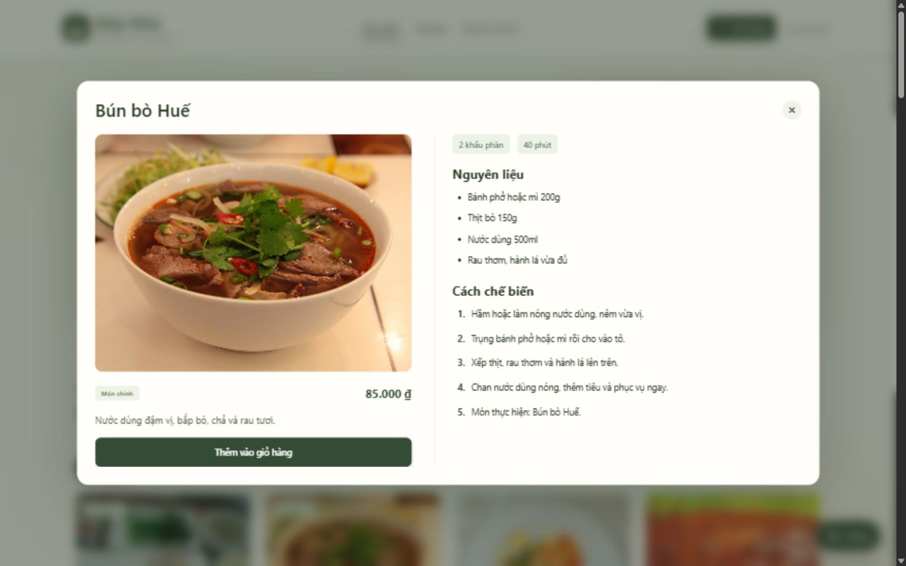
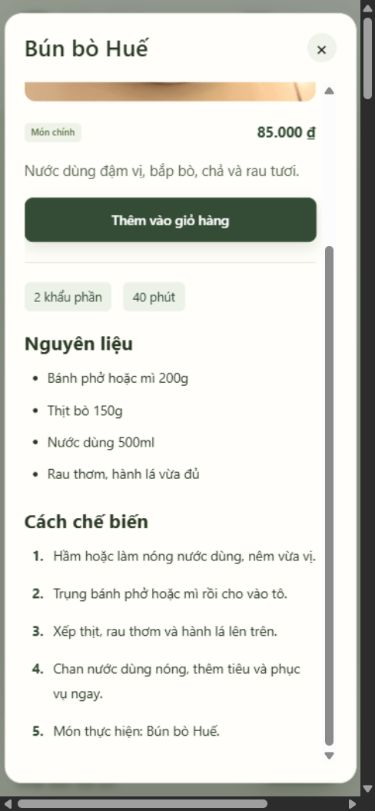

# Bài thực hành số 3 — Triển khai dự án trên GitHub

Người thực hiện: **Lê Minh Nhật**, tài khoản **nhatnha123hehe-sys**. Đây là bài **cá nhân**, áp dụng vào source web Bếp Nhà đã có. Không chia cho David, Ruby hoặc một thành viên giả định. Có sử dụng trợ lý AI để hỗ trợ thực hiện; sinh viên cần đọc hiểu thay đổi và quy trình trước khi trình bày.

Repository: https://github.com/nhatnha123hehe-sys/RestaurantMvc

## Phạm vi và thời gian

Đề cho thời gian thực hiện 2 tuần. Kế hoạch tự đề xuất là 22/10/2026–04/11/2026; đây không phải hạn nộp được giảng viên xác nhận. Các ngày năm 2014 và ứng dụng blog trong đề là ví dụ hướng dẫn.

Milestone: [Sprint 1 - Bài thực hành 3 cá nhân](https://github.com/nhatnha123hehe-sys/RestaurantMvc/milestone/1).

Web nền tảng đã có đăng ký, đăng nhập, đặt bàn, gọi món, hóa đơn, công thức, dashboard và hỗ trợ khách hàng. Không tính các chức năng đã có là code mới của sprint này.

## Công việc trong sprint

| Issue | Nội dung | Người thực hiện | Điểm |
|---|---|---|---|
| [#1](https://github.com/nhatnha123hehe-sys/RestaurantMvc/issues/1) | Cập nhật tài liệu Areas, quy trình cá nhân và mẫu issue/PR | Lê Minh Nhật | 1 |
| [#2](https://github.com/nhatnha123hehe-sys/RestaurantMvc/issues/2) | Đồng nhất ảnh và chia chi tiết món thành hai cột | Lê Minh Nhật | 3 |
| [#3](https://github.com/nhatnha123hehe-sys/RestaurantMvc/issues/3) | GitHub Actions kiểm tra JavaScript và test frontend | Lê Minh Nhật | 1 |

Tổng kế hoạch: 5 điểm. Điểm thể hiện độ phức tạp tương đối, không phải số ngày. Tạo đủ nhãn point:0, point:1, point:3, point:7 theo ví dụ; chỉ gán một nhãn điểm cho mỗi task.

## Quy trình thực hiện

1. Tạo milestone có mục tiêu và deadline.
2. Tạo labels New, In progress, Done, bug, các nhãn điểm và Le Minh Nhat.
3. Tạo issue có tiêu chí hoàn thành, assignee là tài khoản cá nhân và milestone.
4. Đổi nhãn New thành In progress khi bắt đầu làm.
5. Làm thay đổi trên nhánh `codex/lab3-individual-sprint`, commit và push.
6. Mở PR vào main; dùng `Closes #1`, `Closes #2`, `Closes #3` để liên kết các task thực sự được giải quyết. Không dùng `Solve` vì không phải từ khóa tự đóng issue.
7. Kiểm tra diff và kết quả kiểm thử. Bài cá nhân dùng tự rà soát, không giả lập người review thứ hai.
8. Sau khi merge và xác nhận kết quả, đổi nhãn thành Done, đóng các issue và tổng kết milestone.

## Theo dõi tiến độ bằng filter

Trong ô tìm kiếm Issues của repository, dùng các truy vấn sau:

```text
is:issue milestone:"Sprint 1 - Bài thực hành 3 cá nhân"
is:issue assignee:nhatnha123hehe-sys label:"In progress"
is:issue assignee:nhatnha123hehe-sys label:Done
is:issue label:bug
is:issue milestone:"Sprint 1 - Bài thực hành 3 cá nhân" is:closed
```

[Xem tất cả task cá nhân](https://github.com/nhatnha123hehe-sys/RestaurantMvc/issues?q=is%3Aissue%20assignee%3Anhatnha123hehe-sys).

## Minh chứng và giới hạn

Milestone, lịch sử nhãn trên issue, commit, PR và GitHub Actions là minh chứng thực tế. Thời gian hoàn thành được ghi theo lúc thực hiện, không dựng lại lịch sử kéo dài đủ 2 tuần.

Workflow frontend không cần SQL Server; kiểm thử frontend dùng API giả lập nên không chứng minh nghiệp vụ SQL hay toàn bộ website đã đúng. Kiểm thử trình duyệt và kết quả thực thi được bổ sung trong tổng kết sprint.

## Kiểm chứng giao diện ngày 22/10/2026

- `node --check wwwroot/app.js`: đạt.
- `node --test tests/frontend-init.test.cjs`: 10/10 đạt.
- `git diff --check`: không có lỗi whitespace.
- Trình duyệt 1440×900: cửa sổ chi tiết có ảnh bên trái, công thức bên phải.
- DOM xác nhận menu và chi tiết dùng cùng URL ảnh, cùng tỉ lệ 4:3.
- Trình duyệt 390×844: xếp dọc, cuộn tới bước cuối của công thức Bún bò Huế.
- Mở đăng nhập sau chi tiết: class riêng của modal món đã được xóa.
- Không sửa dữ liệu công thức và không chạy lại kiểm thử tích hợp SQL trong sprint này.



