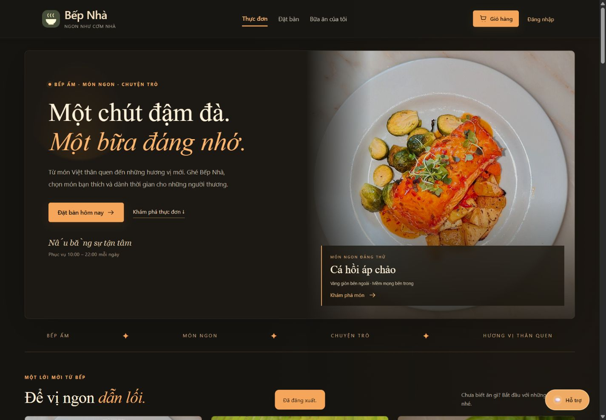
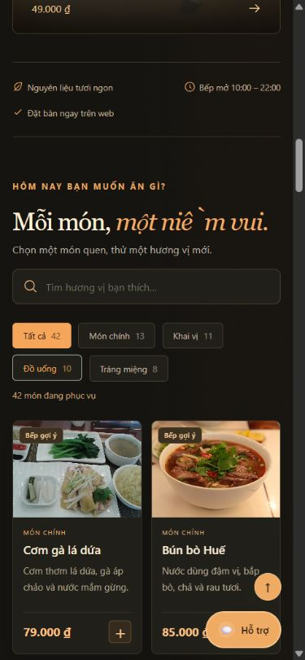

# Giao diện nhà hàng nền tối ngày 28/10/2026

Thay giao diện xanh kem bằng nền than đen, cam mật ong và tiêu đề serif theo ảnh tham khảo. Dùng ảnh thật đã có trong dự án. Thêm ba món gợi ý lấy từ menu hiện tại và khu vực đặt bàn cuối trang. Các thẻ món mở đúng chi tiết; nút khám phá cuộn trong trang mà không thay route.

CSS mới: wwwroot/feast.css, được nạp sau styles.css với asp-append-version. Không đổi database hoặc API.

Kiểm tra:
- Build C#: 0 lỗi, 0 cảnh báo.
- Frontend: 10/10 test đạt; node --check đạt.
- Desktop 1440×1000: banner, menu 42 món, mở chi tiết món hai cột, đăng nhập admin và dashboard, đăng xuất.
- Mobile 390×844: bộ lọc xuống dòng; DOM không tràn ngang (scrollWidth 375, viewport 390 có thanh cuộn); form đăng nhập đọc được.
- Sửa thêm dialog đã đóng vẫn có display:flex từ CSS cũ bằng dialog:not([open]).
- Chưa kiểm thử lại toàn bộ nghiệp vụ đặt bàn, thanh toán và SQL Server; lần thay đổi này tập trung UI.

